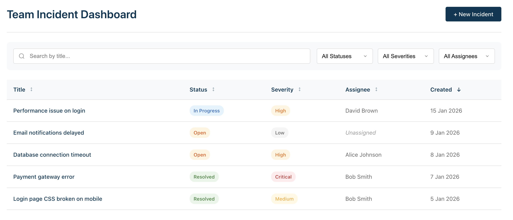
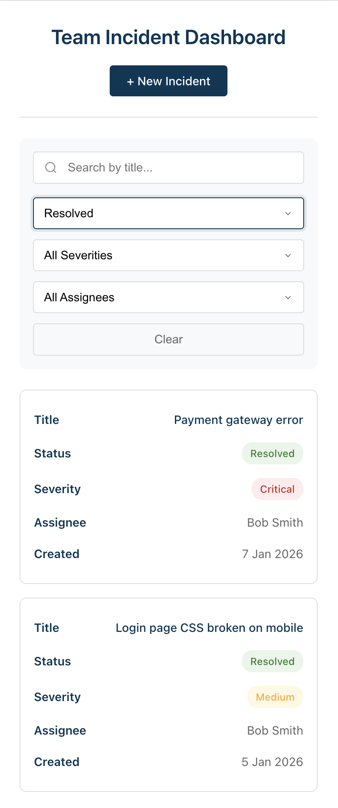
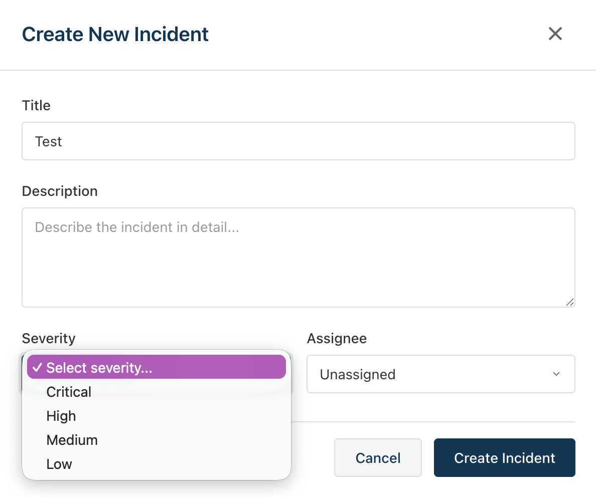
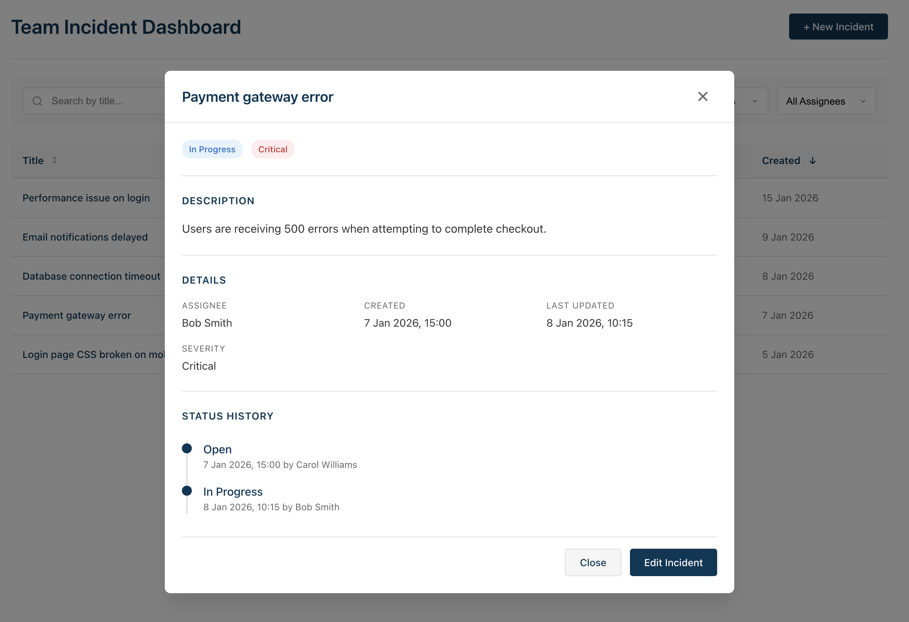

# Team Incident Dashboard

A React + TypeScript incident management dashboard built for the Danske Bank frontend coding challenge. The application allows teams to track, create, and manage incidents with filtering, sorting, and status updates.



## Table of Contents

- [Getting Started](#getting-started)
- [Architecture & Key Decisions](#architecture--key-decisions)
- [Trade-offs & Limitations](#trade-offs--limitations)
- [Screenshots](#screenshots)
- [Use of Tooling/AI](#use-of-toolingai)
- [API Reference](#api-reference)

---

## Getting Started

### Prerequisites

- **Node.js** 18+ (tested with Node 20)
- **npm** (or yarn/pnpm)

### Installation

```bash
npm install
```

### Running the App

```bash
npm run dev
```

Opens the app at [http://localhost:5173](http://localhost:5173)

### Running Tests

```bash
# Run all tests once
npm test

# Run tests in watch mode
npm run test -- --watch

# Run tests with coverage
npm run test -- --coverage
```

**Test Suite:** 102 tests across 10 test files covering components, hooks, utilities, and API.

### Other Commands

```bash
# Build for production
npm run build

# Preview production build
npm run preview

# Lint code
npm run lint

# Format code
npm run format
```

### Assumptions

- Modern browser with ES2020+ support
- JavaScript enabled
- localStorage available (falls back to in-memory storage if not)
- No authentication required (mock API assumes "current-user" for all actions)

---

## Architecture & Key Decisions

### State Management Approach

**Choice: TanStack React Query (v5)**

I chose React Query over alternatives (Redux, Zustand, Context) because:

1. **Server State Focus**: The app is primarily about fetching and mutating server data. React Query excels at this with built-in caching, background refetching, and stale-while-revalidate patterns.

2. **Optimistic Updates**: The `useUpdateIncident` hook implements optimistic updates for instant UI feedback when editing incidents, with automatic rollback on errors.

3. **Minimal Boilerplate**: No actions, reducers, or selectors needed. The hooks (`useIncidents`, `useUsers`, `useCreateIncident`, `useUpdateIncident`) encapsulate all data logic.

4. **Cache Invalidation**: Automatic cache invalidation after mutations keeps the UI in sync without manual state updates.

**Local UI State**: Used React's `useState` for component-local state (form inputs, filters, modal visibility, sort direction). This is ephemeral state that doesn't need to be shared or persisted.

```
┌─────────────────────────────────────────────────────┐
│                    App State                        │
├─────────────────────────────────────────────────────┤
│  Server State (React Query)    │  UI State (useState)│
│  ─────────────────────────────│─────────────────────│
│  • Incidents list              │  • Modal open/close │
│  • Users list                  │  • Filter values    │
│  • Mutation states             │  • Sort field/dir   │
│                                │  • Form inputs      │
│                                │  • Edit mode        │
└─────────────────────────────────────────────────────┘
```

### Data Fetching Strategy

- **Initial Load**: `useQuery` fetches incidents and users on mount
- **Caching**: 
  - Incidents: 1 minute stale time
  - Users: 5 minutes stale time (users change less frequently)
- **Mutations**: `useMutation` with `onSuccess` cache invalidation
- **Optimistic Updates**: Update cache immediately, rollback on error
- **Error Handling**: Retry buttons allow users to recover from failed requests
- **Loading States**: Spinner components and disabled buttons during operations

### File/Folder Structure

```
src/
├── api/                          # Data layer
│   ├── index.ts                  # Barrel export
│   ├── mockApi.ts                # Fetch interceptor with route handlers
│   ├── mockApi.test.ts           # API integration tests
│   ├── seedData.ts               # Default incidents and users
│   ├── storage.ts                # localStorage with memory fallback
│   └── types.ts                  # TypeScript interfaces
│
├── components/
│   ├── common/                   # Reusable UI primitives
│   │   ├── Badge/                # Status/severity badges
│   │   ├── Button/               # Primary/secondary buttons
│   │   ├── Input/                # Text input with validation
│   │   ├── Modal/                # Accessible modal dialog
│   │   ├── Select/               # Dropdown select
│   │   ├── Spinner/              # Loading indicator
│   │   └── index.ts              # Barrel export
│   │
│   ├── FilterBar/                # Search and filter controls
│   ├── IncidentDetail/           # View/edit incident modal content
│   ├── IncidentForm/             # Create incident form
│   └── IncidentList/             # Main table with sorting
│
├── hooks/
│   ├── index.ts                  # Barrel export
│   ├── useIncidents.ts           # Incident CRUD hooks
│   ├── useIncidents.test.tsx     # Hook tests
│   └── useUsers.ts               # Users query hook
│
├── test/
│   ├── setup.ts                  # Vitest/jsdom setup
│   └── test-utils.tsx            # Custom render with providers
│
├── utils/
│   ├── constants.ts              # Severity/status options, sort orders
│   ├── formatters.ts             # Date formatting utilities
│   └── formatters.test.ts        # Formatter tests
│
├── App.tsx                       # Main app component
├── App.test.tsx                  # Integration tests
├── App.css                       # Global app styles
├── index.css                     # CSS reset and variables
└── main.tsx                      # Entry point with API init
```

**Design Principles:**
- **Colocation**: Each component has its own folder with `.tsx`, `.module.css`, and `.test.tsx`
- **Barrel Exports**: `index.ts` files for cleaner imports
- **Separation of Concerns**: Hooks handle data, components handle UI
- **CSS Modules**: Scoped styles prevent conflicts

---

## Trade-offs & Limitations

### Current Limitations

1. **No Real Authentication**: The mock API uses a hardcoded "current-user" for all status history entries. A real app would integrate with an auth provider.

2. **Client-Side Filtering/Sorting**: All filtering and sorting happens in the browser. With large datasets (1000+ incidents), this should move to the API with pagination.

3. **Limited Form Fields**: The edit modal only allows changing status and assignee. A full implementation would allow editing all fields.

4. **No Delete Functionality in UI**: The API supports DELETE but there's no UI button for it. This was intentional for the MVP scope.

5. **No Offline Support**: The app requires network connectivity. Service workers could enable offline viewing.

### What I Would Improve With More Time

| Area | Improvement |
|------|-------------|
| **UX** | Add toast notifications for success/error feedback |
| **Performance** | Add search debouncing (300ms) |
| **Performance** | Virtual scrolling for large lists |
| **Performance** | Server-side pagination |
| **Testing** | Add E2E tests with Playwright |
| **Testing** | Visual regression tests |
| **Accessibility** | Screen reader announcements for dynamic content |
| **Features** | Bulk actions (assign multiple incidents) |
| **Features** | Export to CSV |
| **Features** | Real-time updates via WebSocket |
| **Code Quality** | Add Storybook for component documentation |

### Technical Debt

- The `useEffect` in `IncidentForm` depends on callback stability from parent
- Some test files could be DRYer with shared fixtures

---

## Features

### Core Functionality

- ✅ **View Incidents**: Sortable table displaying all incidents with status, severity, assignee, and dates
- ✅ **Create Incident**: Modal form with validation for title, description, severity, and optional assignee
- ✅ **Edit Incident**: Update status and assignee with optimistic updates
- ✅ **Filter & Search**: Filter by status, severity, assignee, or search by title
- ✅ **Sort**: Click column headers to sort ascending/descending

### User Experience

- ✅ **Loading States**: Spinner during data fetching, "Creating..."/"Saving..." button text during mutations
- ✅ **Error Handling**: Retry buttons for failed requests
- ✅ **Unsaved Changes Warning**: Confirmation dialog when closing edit modal with unsaved changes
- ✅ **Browser Tab Warning**: `beforeunload` event prevents accidental data loss when closing tab
- ✅ **Responsive Design**: Works on desktop, tablet, and mobile devices
- ✅ **Keyboard Navigation**: Table rows are focusable and selectable via Enter/Space
- ✅ **Accessible Modals**: Focus trap, Escape to close, ARIA attributes

---

## Screenshots

### Desktop View


*Main dashboard showing incident list with filters, sorting, and status badges. The table displays all incidents with their severity, status, assignee, and creation date.*

### Mobile/Tablet View



*Responsive design on smaller screens. The filter bar stacks vertically and the table becomes scrollable horizontally with data labels for each cell.*

### Create Incident Modal



*Form for creating new incidents with validation. Required fields show error messages when empty.*

### Incident Detail Modal



*Viewing incident details with status history timeline. Edit mode allows changing status and assignee.*


---

## Use of Tooling/AI

### AI Assistance

I used **GitHub Copilot (Claude)** throughout development for:

1. **Test Scaffolding**: Generated initial test files for all components, then adapted assertions for specific edge cases and fixed test isolation issues.

2. **Code Review**: Used AI to perform thorough code reviews, identifying bugs (e.g., handleRetry validation bypass, isEditing state not resetting) and suggesting improvements.

3. **Debugging**: Collaborated on fixing test failures related to localStorage unavailability in jsdom, leading to the memory fallback implementation in `storage.ts`.

4. **Feature Implementation**: Implemented unsaved changes confirmation dialog with AI assistance, including the parent-child communication pattern via `onUnsavedChanges` callback.

5. **Documentation**: This README was structured with AI assistance based on the challenge requirements.

6. **CSS Styling**: Generated responsive CSS module styles with proper breakpoints and accessibility considerations.

### Other Tools

- **Vite**: Build tool and dev server with instant HMR
- **Vitest**: Test runner compatible with Vite's config
- **React Testing Library**: Component testing with user-centric queries
- **ESLint + Prettier**: Code formatting and linting
- **TypeScript**: Static type checking

---

## API Reference

The mock API intercepts `fetch()` requests and persists data in localStorage.

### Endpoints

| Method | Endpoint | Description |
|--------|----------|-------------|
| `GET` | `/api/incidents` | List all incidents |
| `GET` | `/api/incidents/:id` | Get incident by ID |
| `POST` | `/api/incidents` | Create new incident |
| `PATCH` | `/api/incidents/:id` | Update incident |
| `DELETE` | `/api/incidents/:id` | Delete incident |
| `GET` | `/api/users` | List all users |
| `POST` | `/api/reset` | Reset data to defaults |

### Types

```typescript
type IncidentStatus = "Open" | "In Progress" | "Resolved";
type IncidentSeverity = "Low" | "Medium" | "High" | "Critical";

interface Incident {
  id: string;
  title: string;
  description: string;
  status: IncidentStatus;
  severity: IncidentSeverity;
  assigneeId: string | null;
  createdAt: string;      
  updatedAt: string;      
  statusHistory: StatusHistoryEntry[];
}

interface CreateIncidentInput {
  title: string;
  description: string;
  severity: IncidentSeverity;
  assigneeId: string | null;
}

interface UpdateIncidentInput {
  title?: string;
  description?: string;
  status?: IncidentStatus;
  severity?: IncidentSeverity;
  assigneeId?: string | null;
}
```

### Example Usage

```typescript
// Fetch all incidents
const response = await fetch("/api/incidents");
const incidents = await response.json();

// Create an incident
const response = await fetch("/api/incidents", {
  method: "POST",
  headers: { "Content-Type": "application/json" },
  body: JSON.stringify({
    title: "Server outage",
    description: "Production server is unresponsive",
    severity: "Critical",
    assigneeId: "user-1",
  }),
});

// Update incident status
const response = await fetch("/api/incidents/inc-1", {
  method: "PATCH",
  headers: { "Content-Type": "application/json" },
  body: JSON.stringify({
    status: "In Progress",
    assigneeId: "user-2",
  }),
});
```

---

## License

This project was created for a coding challenge and is not licensed for public use.
